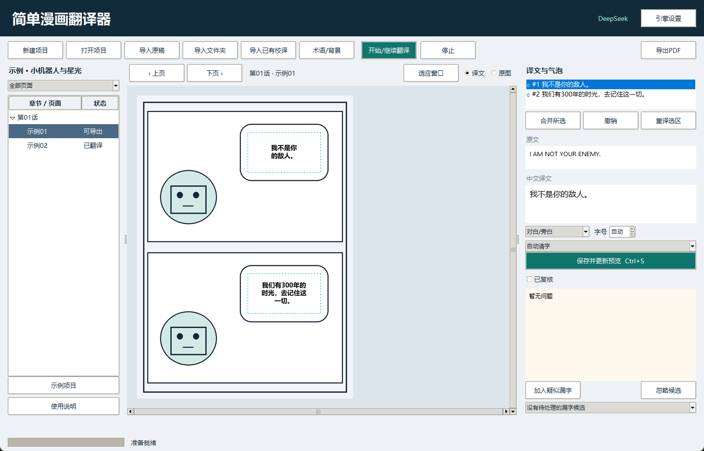

# 简单漫画翻译器

Windows 漫画翻译工具。导入原稿，批量翻译，在气泡中嵌入中文，导出 PDF。



## 功能

- 导入图片、PDF、CBZ、ZIP 和文件夹。
- 本地英文、中英文 OCR，可选云端视觉识别。
- 接入 DeepSeek 和兼容 Chat Completions 的接口。
- 编辑原文与译文，拖动文字框，合并气泡，调整字号。
- 术语表、译文缓存、任务暂停与继续。
- 检查漏译、重叠和越界，输出 PDF、译文 CSV 和检查报告。

## 下载

在 [Releases](https://github.com/JoeyLee2002/simple-manga-translator/releases/latest) 下载 Windows 便携版，完整解压后运行 `简单漫画翻译器.exe`。请保留同目录的 `_internal` 文件夹。

## 使用

新建项目 → 引擎设置 → 导入原稿 → 开始/继续翻译 → 核对修改 → 导出 PDF。

DeepSeek 的默认地址为 `https://api.deepseek.com`，模型为 `deepseek-flash`。填写自己的 API 密钥后即可使用；也可修改接口地址和模型。

详细操作见 [使用说明](docs/使用说明.md)。

## 源码运行

需要 Windows 10/11、Python 3.10，以及系统中的微软雅黑或宋体。

```powershell
python -m venv .venv
.\.venv\Scripts\python.exe -m pip install -r requirements.txt
.\.venv\Scripts\python.exe tools/setup_models.py
.\.venv\Scripts\python.exe run.py
```

模型下载来自 RapidAI 发布的 OCR 模型，文件哈希在下载脚本中固定。

## 测试

```powershell
.\.venv\Scripts\python.exe -m unittest discover -s tests -v
```

## 构建 Windows 版

```powershell
.\.venv\Scripts\python.exe -m pip install -r requirements-build.txt
.\.venv\Scripts\python.exe tools/build_windows.py
```

输出目录为 `发行版/简单漫画翻译器`。

## 文件与接口

项目由 `project.json`、`images` 和 `pages` 组成，可整体备份。程序配置和译文缓存存放在 `%LOCALAPPDATA%/MangaTranslatorStudio`。

英文及中英 OCR 在本地运行，只将识别文字发送到翻译接口；云端视觉 OCR 会向所配置的接口发送整页图片。“在线翻译”使用非官方接口，可能受到限流。

## 许可

[AGPL-3.0](LICENSE)。第三方依赖和 OCR 模型见 [THIRD_PARTY_NOTICES.md](THIRD_PARTY_NOTICES.md)。
