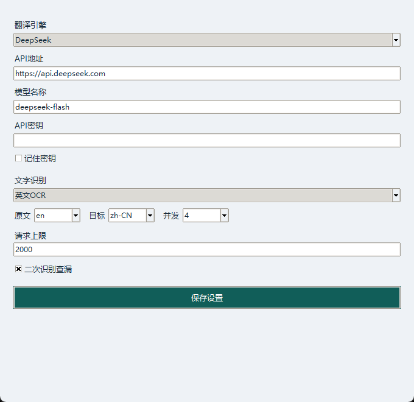

# 安装与部署

本项目是 Windows 桌面程序，可以下载便携版直接运行，也可以通过源码安装。

## 下载便携版

1. 进入 [Releases](https://github.com/JoeyLee2002/simple-manga-translator/releases/latest)。
2. 下载 `simple-manga-translator-windows-x64-版本号.zip`。
3. 使用“全部解压”将压缩包展开到一个文件夹。
4. 进入 `simple-manga-translator` 文件夹，双击 `简单漫画翻译器.exe`。

典型目录如下：

```text
simple-manga-translator/
├─ 简单漫画翻译器.exe
├─ _internal/
│  ├─ assets/models/
│  └─ ...运行库
├─ docs/
├─ README.md
├─ LICENSE
└─ THIRD_PARTY_NOTICES.md
```

程序和 `_internal` 应保持在同一目录。项目文件可另外存放，例如 `D:\MangaProjects\项目名`。

## 系统要求

- Windows 10/11，64位。
- 系统中安装了微软雅黑或宋体。
- 可以访问所使用的在线翻译服务。
- 源码安装推荐 Python 3.10。便携版已经包含所需运行环境。

OCR 在 CPU 上运行；安装和使用无需配置 CUDA。

## 从源码安装

在 PowerShell 中逐行执行：

```powershell
git clone https://github.com/JoeyLee2002/simple-manga-translator.git
cd simple-manga-translator
py -3.10 -m venv .venv
.\.venv\Scripts\python.exe -m pip install -r requirements.txt
.\.venv\Scripts\python.exe tools/setup_models.py
.\.venv\Scripts\python.exe run.py
```

若系统未提供 `py`，使用已安装的 Python 3.10 执行第一条创建虚拟环境的命令：

```powershell
python -m venv .venv
```

模型准备完成后，目录中应有：

```text
assets/models/en_rec.onnx
assets/models/en_dict.txt
```

模型脚本会检查 SHA-256。网络中断后可重新执行该脚本，已通过校验的文件会复用。

## 配置 DeepSeek

1. 登录 [DeepSeek 开放平台](https://platform.deepseek.com/)，创建自己的 API 密钥。
2. 打开程序右上角的“引擎设置”。
3. 引擎选择 `DeepSeek`，地址填写 `https://api.deepseek.com`。
4. 模型名称默认 `deepseek-flash`；如果服务商提供的模型名称发生变化，按账户支持的名称修改。
5. 填写密钥，点击“保存设置”。



英文漫画可先用以下设置：

| 设置 | 建议值 |
| --- | --- |
| 文字识别 | 英文OCR |
| 原文 | en |
| 目标 | zh-CN |
| 并发 | 4，限流时降低为1或2 |
| 二次识别查漏 | 开启后会增加本地识别耗时，并列出疑似漏字 |

勾选“记住密钥”后，密钥会按当前 Windows 账户加密保存。换电脑或换 Windows 账户时重新填写。

## 自定义接口与其他语言

引擎选择“自定义API”，填写服务地址、模型名称和密钥。服务需兼容 Chat Completions，并支持 JSON 对象输出。

云端视觉OCR还要求模型支持图片输入。普通英文/中英 OCR 在本地运行；云端视觉OCR会发送整页图片到所配置的接口。

日文、韩文等原稿建议先使用支持对应语言的视觉接口测试少量页面，再批量处理。

## 项目存储与备份

每个项目由以下内容组成：

```text
项目目录/
├─ project.json
├─ images/
└─ pages/
```

复制整个项目目录即可备份。程序的设置与译文缓存另存于：

```text
%LOCALAPPDATA%\MangaTranslatorStudio
```

停止任务后等待当前处理结束再关闭。下次打开同一项目，可点击“开始/继续翻译”。已有译文可继续编辑；单独重译使用“重译选区”。

## 从源码构建Windows版

先完成源码安装和模型下载，再执行：

```powershell
.\.venv\Scripts\python.exe -m pip install -r requirements-build.txt
.\.venv\Scripts\python.exe -m unittest discover -s tests -v
.\.venv\Scripts\python.exe tools/build_windows.py
```

构建输出位于：

```text
发行版/简单漫画翻译器/
```

完整打包该文件夹，并随包保留源码获取地址、许可证与第三方声明。

## 更新版本

下载新版本并解压到新的程序目录，打开原来的 `project.json` 即可继续处理。项目目录和程序配置可以独立于程序文件保存。

## 排错

### 界面能打开，但翻译失败

先在“引擎设置”核对地址、模型和密钥。到服务商后台确认账号权限与余额，再确认当前网络可以访问该 API。失败页会标为“失败”，完成的页面仍保存在项目中。

### 启动时报字体错误

程序从系统读取微软雅黑或宋体。安装对应中文字体后重新运行。

### 启动时提示缺少模块或DLL

便携版请确认 ZIP 已完整解压，`_internal` 与 EXE 在同一目录。源码版使用 `.venv\Scripts\python.exe` 启动，并在同一虚拟环境中安装依赖。

### 模型下载失败

确认网络可以访问 ModelScope，再执行 `tools/setup_models.py`。哈希不匹配时脚本会报错，可重新下载并校验。

### 导入后页数少于预期

程序会跳过像素完全相同的页面，包括重复空白页。按文件名中的数字排序导入；多次导入会追加到项目末尾。

### 文字没有装进气泡

先核对原文是否识别完整，再修改译文、字号和文字框。属于同一气泡的分块可合并。复杂背景可调整清字方式，并查看右侧复核提醒。

### 导出被阻止

根据错误页码修复漏译、重叠或越界，再次导出。导出的 CSV 可用于整理译文，JSON 检查报告保留页面和文字区信息。
